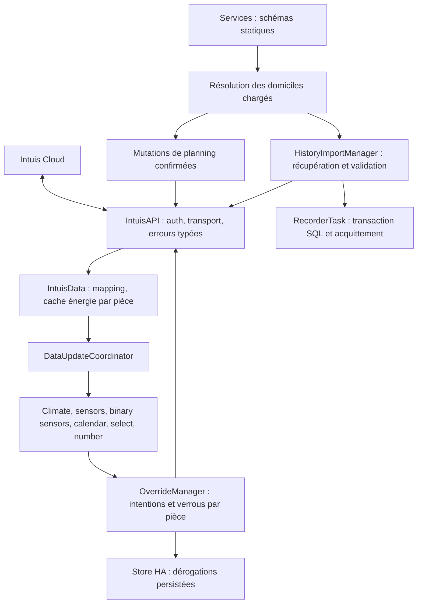

# Architecture de l’intégration Intuis Connect

Une entrée de configuration représente un domicile. Elle possède un client
`IntuisAPI`, un modèle `IntuisHome`, un coordinateur `IntuisData` et un gestionnaire
de dérogations. Les identifiants des entités incluent le domicile ; les services
sont enregistrés une seule fois au niveau du domaine.

## Flux principal

Le polling nominal est de deux minutes. Après limitation API, l’intervalle peut
augmenter jusqu’au plafond configuré, puis récupérer progressivement. Le client
essaie les clusters configurés pendant le login ; les requêtes authentifiées
utilisent le serveur retenu ou leur URL complète spécifique. Un retry après 401
conserve la destination, le corps, les en-têtes spécifiques et le timeout.

## Sources d’état et responsabilités

| Module | Responsabilité et état possédé |
|---|---|
| `__init__.py` | Création/arrêt des objets par entrée, chargement des plateformes et du stockage |
| `intuis_api/api.py` | Transport, tokens, throttling et erreurs typées ; aucune erreur de mesure convertie en zéro |
| `intuis_api/mapper.py` | Reconstruction des modules/pièces depuis le statut cloud |
| `intuis_data.py` | Mise à jour, compteurs et dernières mesures énergétiques valides par pièce |
| `overrides.py` | Dictionnaire partagé des intentions, commandes et prolongations sérialisées par pièce |
| `climate.py` | État observé et commande optimiste bornée à 120 secondes, minuteries annulables |
| `timetable.py` | Transformation pure de plages semi-ouvertes dans une semaine cyclique |
| `schedule_mutations.py` | Payload commun aux services/number, copie sous verrou et publication après succès |
| `service_targets.py` | Snapshot et résolution des entrées actuellement chargées |
| `services.py` / `services.yaml` | Schémas et orchestration ; descriptions statiques sans écriture dans le composant |
| `history_import.py` | Une tâche d’import par entrée, validation des jours locaux clos, progression et annulation |
| `recorder_import.py` | Remplacement transactionnel sur le vrai worker recorder et confirmation après commit/rollback |
| `entity/intuis_*.py` | Modèles du domicile, pièces, modules et plannings |

Le dictionnaire des dérogations reste le même objet pour les commandes climate,
le coordinateur et la persistance. `OverrideIntent` décrit son format stocké ;
il ne crée ni conversion ni seconde copie d’état à l’exécution. Seul le snapshot
envoyé au Store est copié pour ne pas changer pendant sa sérialisation.

L’affichage optimiste climate est une commande en attente, séparée des intentions
persistées. Une confirmation cloud l’efface ; son délai local expire aussi quand
le cloud est indisponible. Les dernières mesures énergétiques possèdent leur
journée et leur horodatage : une pièce absente n’est pas une consommation nulle,
et un total domicile incomplet reste identifiable comme ancien/incomplet.

## Modifications de planning et services

Les entités `number` et les services passent par le même module de mutation.
Le modèle courant est résolu sous le verrou du planning, copié, envoyé, puis
publié seulement après succès API. L’intervalle remplacé est intégralement
couvert, avec restauration de la zone de fin et conservation du complément.
Les verrous protègent les appels de cette intégration ; ils ne constituent pas
un verrou distribué avec l’application Intuis.

Les cinq services acceptent `home_id`. Sans cible, les mutations utilisent la
première entrée chargée et les opérations refresh/import visent tous les domiciles
éligibles. Les noms sont validés au moment de l’appel sur les modèles courants.
Un rafraîchissement ne réécrit pas de YAML et les services restent disponibles
jusqu’au dernier déchargement réussi.

## Historique énergétique et cycle de vie

L’import récupère et valide toute la série d’une pièce avant de modifier le
recorder. Il remplace uniquement des jours locaux clos, exige une baseline live
short-term compatible, et réalise suppression, insertion et décalage des sommes
dans une transaction. Une réponse vide, incomplète ou incompatible laisse les
statistiques existantes intactes. La confirmation attend le commit ou le rollback.

Le déchargement empêche de nouveaux imports, annule les traitements et attend les
transactions et écritures de progression engagées. Les minuteries des entités
climate sont retirées avec leurs listeners ; une réponse tardive ne les réactive
pas. Les identifiants et les clés de stockage ne sont pas changés par ces correctifs.

## Plateformes et validation

Les plateformes créent les entités climate, températures mesurées et planifiées,
énergie/minutes, expiration de consigne, diagnostics modules, présence/fenêtre/
anticipation, calendriers, choix du planning et températures de zones. La consigne
cible et l’action de chauffage sont aussi exposées par l’entité climate ; elles ne
supposent pas l’existence d’un capteur séparé.

La matrice locale et CI cible HA 2024.6.4/Python 3.12 et HA 2026.10.4/Python 3.14.
Les tests utilisent transport HTTP simulé, registries et Store natifs, ainsi que le
vrai worker recorder avec SQLite temporaire ; aucun compte Intuis n’est nécessaire.
Voir [développement](development.md), [plan des tests](../tests/PLAN.md),
[dérogations](09-heating-overrides.md), [plannings](07-schedule-management.md),
[import sécurisé](08-safe-energy-history-import.md) et
[services multi-domicile](10-multi-home-services.md).
